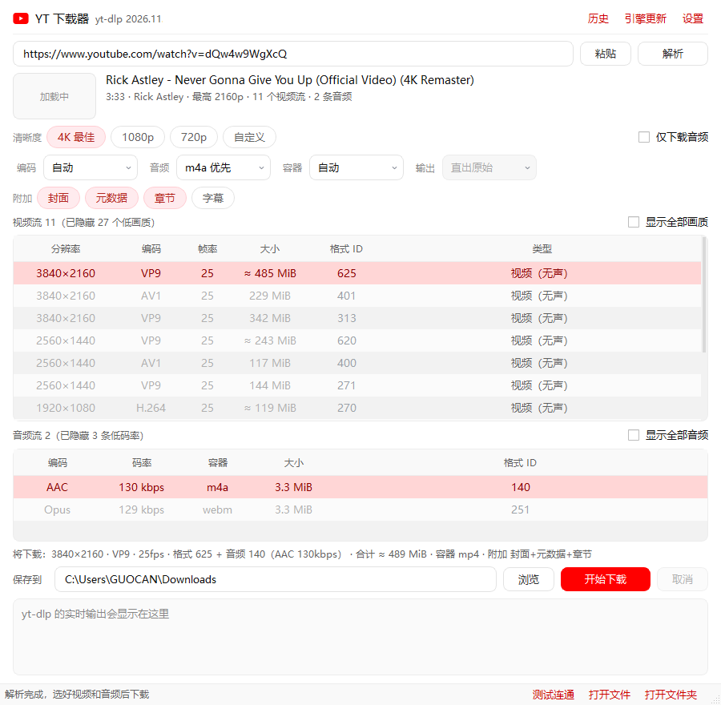

# YT 下载器（yt-dlp GUI）

基于 [yt-dlp](https://github.com/yt-dlp/yt-dlp) 的 Windows 图形界面，把原来在 PowerShell 里敲的一长串参数变成点几下就能完成。



## 环境要求

- **Windows 10 / 11（64 位）**
- Python 3.10+（`setup.bat` 会在项目内建独立 `.venv`，不污染系统环境）
- **ffmpeg**：合并音视频用。没有它只能下「自带音频」的合并流
- **deno**：YouTube 解析必需（yt-dlp 用它计算签名挑战）

ffmpeg / deno 是否可用，看窗口底部状态栏——会常驻显示 `Deno x.x.x · ffmpeg x.x.x · 代理 ...`，缺哪个会标红。两者都不需要手动配置路径，装在 PATH 里即可；也可以到 设置 里指定。

## 启动

1. **第一次**：双击 `setup.bat`，自动创建 `.venv` 并安装 `PySide6-Essentials==6.12.*`（需要联网，几分钟）。
2. **之后**：双击 `run.bat`。

出问题看 `run_debug.bat`（保留控制台，能看到完整报错）。

> `run.bat` 只认项目内的 `.venv`，不会用系统 PATH 里的 Python。因为系统 Python 通常没装 PySide6，直接 `python main.py` 会 ImportError 静默闪退，双击看起来就是「点了没反应」。

## 打包成 exe（可选）

不想装 Python 环境时，可以打成绿色版：

```bat
.venv\Scripts\python.exe -m pip install -r requirements-dev.txt   :: 首次装 PyInstaller
.venv\Scripts\python.exe tools\build_exe.py                      :: 正式版（无控制台）
.venv\Scripts\python.exe tools\build_exe.py --console            :: 排错版
```

产物：`dist/YT下载器/`（约 125MB，解压即用，不依赖 Python 环境）+ `archives/YT下载器_v<版本>_win64.zip`。

**yt-dlp.exe 放在 exe 同级目录**，不是塞进 `_internal`。这样点「引擎更新」能直接替换它，不必重新打包整个程序。

启动失败时看 exe 同级的 `startup_error.log`（无控制台的程序看不到 traceback，所以特意写文件）。

## 界面怎么用

**视频和音频是两张独立的表，自由组合。**

- 上面的「视频流」表：默认只显示 1080p 及以上（勾「显示全部画质」可看到 720p/480p），标题会写「已隐藏 N 个低画质」
- 下面的「音频流」表：选定视频后会自动按「音频」下拉的偏好配一条，避免下到没声音的视频；也可以手动点别的。默认只显示 100kbps 及以上的音轨，勾「显示全部音频」才看得到 48/64kbps 的低码率音轨
- **「仅下载音频」**：忽略视频选择，只下音频。「输出」下拉决定要哪种：
  - `直出原始`（默认）：保留 m4a / webm 原样，不转码，最快且无损
  - `转 mp3`：转成 mp3 320k，兼容性最好
- 底部摘要行实时显示组合：`3840×2160 · VP9 · 25fps · 格式 625 + 音频 140（AAC 130kbps） · 合计 ≈ 489 MiB · 容器 mkv`

**文件名规则**：`标题.版本标签.扩展名`，点号分隔，同一视频的不同版本永不撞名。

```
... (4K Remaster).2160p.VP9.mkv      VP9(webm) + m4a 音频
... (4K Remaster).2160p.AV1.mp4      AV1(mp4) + m4a 音频
... (4K Remaster).1080p.H264.mp4
... (4K Remaster).audio.m4a          仅音频 · 直出原始
... (4K Remaster).audio.mp3          仅音频 · 转 mp3
```

高度未知的流会退化成 `.VP9.625.mkv`。文件名长度上限按保存目录自动计算（给 Windows 260 字符路径限制留余量），目录越深，标题允许的长度越短。

**容器（mp4 / webm / mkv）怎么自动选**

默认「自动」时，程序**不传** `--merge-output-format`，完全由 yt-dlp 决定。规则（已按其源码 `get_compatible_ext()` 复刻）：

1. 先看编码：能塞进 **mp4** 就 mp4（H.264 / HEVC / AV1 + AAC）
2. 不行看 **webm**（VP8 / VP9 / AV1 + Opus / Vorbis）
3. 都不行才落 **mkv**（什么都能装）

| 视频流 | 音频流 | 结果 | 原因 |
|---|---|---|---|
| mp4 H.264 | m4a AAC | `.mp4` | 编码全在 mp4 白名单 |
| mp4 AV1 | m4a AAC | `.mp4` | AV1 也在 mp4 白名单 |
| **mp4 VP9** | **m4a AAC** | **`.mp4`** | VP9 不在白名单，但两条流都是 mp4 族 → 兜底保留 |
| webm VP9 | webm Opus | `.webm` | 编码全在 webm 白名单 |
| mp4 AV1 | webm Opus | `.webm` | AV1+Opus 都在 webm 白名单 |
| mp4 VP9 | webm Opus | `.webm` | AV1/VP9+Opus 都在 webm 白名单 |
| webm VP9 | m4a AAC | `.mkv` | 编码与扩展名都对不上 |
| mp4 H.264 | webm Opus | `.mkv` | 同上 |

注意第 3 行：YouTube 的 4K VP9 有两种来源——webm 的（如 313）和 mp4 封装的（如 625）。后者虽然编码是 VP9，但两条流同属 mp4 族，yt-dlp 会兜底成 `.mp4`，不是 mkv。

以上 7 种组合都与真下载结果逐一核对过。摘要行末尾显示的是**预测值**，历史去重也用它。

也可以强制 mp4 / mkv。注意：强制 mp4 时即使音轨是 Opus，ffmpeg 也会成功（原样装进去，不转码），但很多播放器不认，表现为黑屏或没声音。

**附加项怎么选**

默认的「封面 + 元数据 + 章节」适合九成场景：只多花 1~2 秒 remux，不改变兼容性，文件大几百 KB。逐项判断：

| 附加项 | 什么时候要 | 什么时候不要 | 代价 |
|---|---|---|---|
| **封面** | 本地收藏、想在播放器/资源管理器里看到海报 | 文件要发给别人或上传平台；用 webm（本来就不支持） | +100~500KB；个别老电视对带封面的 mp4 挑剔 |
| **元数据** | 基本一直开。播放器标题栏显示真名，媒体库能按作者/日期归类 | 你要把文件改成别的用途，标签会和文件名对不上 | 几百字节，可忽略 |
| **章节** | 长视频、教程、访谈——进度条上能直接跳段 | 短视频（10 分钟内基本没章节，开了也白开） | 几乎为零；webm 不支持 |
| **字幕** | 外语视频、要静音看、想做笔记或翻译 | 纯音乐/无旁白；你只需要画面 | 多一次网络请求（容易 429）；mp4/webm 会多出 `.srt`；mkv 内嵌只增几 KB |

**四个常见场景，照抄即可：**

| 你的目的 | 容器 | 附加项 |
|---|---|---|
| 存着自己看 | 自动 | 封面 + 元数据 + 章节（默认） |
| 归档成片库 | 自动（多半落 mkv） | 默认三项 **+ 字幕**（mkv 会内嵌，单文件带字幕） |
| 发给别人 / 投屏 / 手机看 | **强制 mp4** | 只留元数据（封面在个别电视上可能不认） |
| 只要画面，不要花哨 | 自动 | 全关，最纯净 |

一句话：**封面管好看、元数据管认得出、章节管跳转、字幕管看懂**。前三个几乎零成本，字幕是唯一有网络风险的——所以它默认关着。

**键盘流**

| 按键 | 作用 |
|---|---|
| `Ctrl+V` | 粘贴并直接解析（光标在输入框里则正常粘贴） |
| `Enter` | 开始下载（光标在链接框时是解析） |
| `Esc` | 取消下载 |

**下载完成后**：状态栏出现「打开文件」，摘要行右侧出现低调的「再下一次（换个画质）」。

**下载历史**：右上角「历史」可查看下过什么、双击直接打开文件。去重键是 `视频ID + 视频格式 + 音频格式 + 容器`——只有完全相同的组合才跳过，换画质/编码/容器不会互相顶掉。命中时会提示「这个组合已经下过了」，并给一个「仍要重新下载」（会覆盖已有文件）。

**大小估算**：部分格式（典型是 4K VP9 的 m3u8 流，如 625）没有真实文件大小，会用「码率 × 时长」推算，显示为 `≈ 485 MiB`；合计也会带 `≈`。

## 常见问题

| 现象 | 处理 |
|---|---|
| 提示「要求验证身份」或 403 | 请求频率过高或被限流。稍等几分钟；或到 设置 → Cookie 来源改用浏览器 / cookies.txt |
| 下完播放器黑屏 | VP9 被塞进了 mp4。容器改成「自动」或「mkv」 |
| 提示「这个组合已经下过了」 | 同画质+编码+容器下过一次。换组合，或点「仍要重新下载」 |
| 找不到刚下的文件 | 点状态栏「打开文件」，直接打开那个文件 |
| 取消后目录里多了 .part 文件 | 这是故意保留的，下次同一组合会自动续传。要清理去 设置 → 维护 → 清理临时文件 |
| 双击 `run.bat` 没反应 | 先跑一次 `setup.bat`；仍不行用 `run_debug.bat` 看报错 |
| 代理连不上 | 状态栏点「测试连通」。代理软件换端口后，设置里改成手动填 |

**cookies.txt 怎么来**：用浏览器扩展导出 Netscape 格式的 cookies 文件（常用的是 *Get cookies.txt LOCALLY*），在 设置 → `cookies.txt` 里指定路径。它优先于「Cookie 来源」里的浏览器选项，且不需要退出浏览器。

## 和命令行版本的关系

命令行用法完全不受影响，桌面上的 `yt-dlp.exe` + `yt-dlp.conf` 保持原样。本程序只调用**自己目录下**的 `yt-dlp.exe`，并且每次调用都带 `--ignore-config`：

- 你在外部改 `yt-dlp.conf` 不会让 GUI 行为变得不可预测；
- 想复用旧配置，去 设置 → 高级参数 → 「从 conf 导入」，格式/合并类参数由界面接管，会被自动忽略。

## 存档与回退

```bat
.venv\Scripts\python.exe tools\snapshot.py            :: 用当前版本号打包
.venv\Scripts\python.exe tools\snapshot.py 备注文字    :: 带备注
```

产出 `archives/v<版本>_<时间>_<备注>.zip`，内含源码、文档、截图、配置和 `MANIFEST.txt`（记录版本、时间、环境版本）。回退就是解压到新目录 + 重跑 `setup.bat`。

## 想改代码

看 `HANDOFF.md`：架构、15 条设计决策（含「为什么这么做」和「替代方案」）、故障排查表、回归清单。引擎还有哪些能力没用上，看 `docs/yt-dlp-feature-map.md`。

一句话概括技术选型：解析走 `-J` 的 JSON（不解析 `-F` 文本表）、进度走 `--progress-template`（不抓 `[download] 12%`）、参数以列表传 `Popen`（不经 shell，中文路径安全）。

## 尚未做（下一步候选）

批量队列、字幕/封面嵌入、播放列表整包、限速、PyInstaller 打包。
